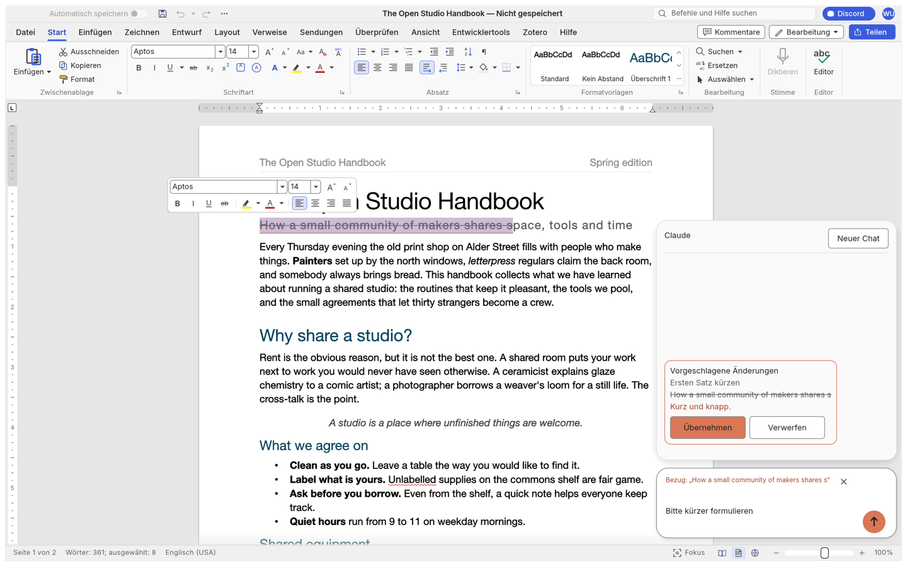
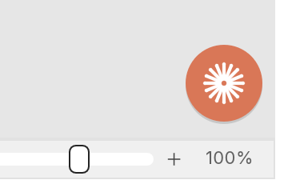
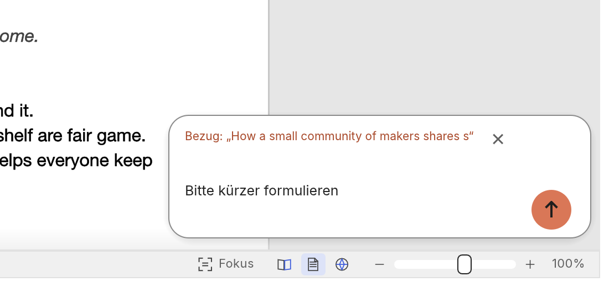
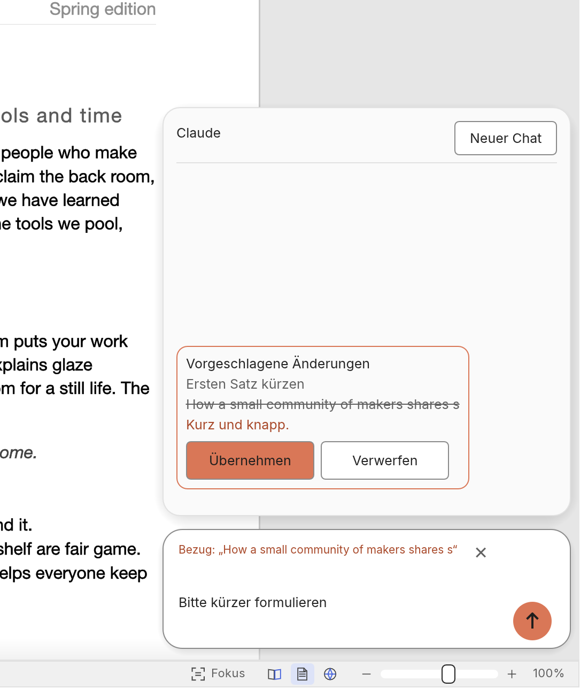

# Claude-Chat-Panel in WordCraft

Ein schwebendes Chat-Panel für den Open-Source-Textverarbeiter [WordCraft](https://github.com/storytold/wordcraft). Claude beantwortet darin Fragen zum offenen Dokument und schlägt Änderungen vor. Ins Dokument kommen sie erst, wenn du auf **Übernehmen** klickst.

Das Backend ist [Claude Code](https://claude.com/claude-code) auf deinem eigenen Rechner (`claude -p`). Ein API-Schlüssel wird nicht gebraucht, es läuft über dein Claude-Abo.



## Funktionen



- **Kreis unten rechts.** Ein Klick oder ⌘⌥K (Strg+Alt+K) klappt ihn zur Eingabepille auf.
- **Eingabe.** Enter sendet, Shift+Enter macht eine neue Zeile. Die Pille wächst nach oben bis zu acht Zeilen mit.
- **Antworten** werden gestreamt. Sie stehen in einem Quadrat mit abgerundeten Ecken über der Pille, die neueste unten.
- **Markierung als Bezug.** Markierter Text erscheint als Chip und gilt als Kontext für die Frage. Mit dem X entfernst du ihn wieder.
- **Erst fragen, dann ändern.** Claude ändert das Dokument nie selbst. Ein Vorschlag zeigt den alten Text durchgestrichen und den neuen in Orange. Erst **Übernehmen** wendet ihn an.
- **Ein Undo-Schritt.** Eine übernommene Änderung nimmst du mit einem einzigen ⌘Z vollständig zurück.
- **Animation.** Neuer Text leuchtet kurz auf und wird aufgedeckt. Die Option „Animationseffekte“ von WordCraft schaltet das ab.
- **Schließen und neu anfangen.** Escape schließt das Panel, „Neuer Chat“ leert den Verlauf.
- **Barrierefrei.** Alles ist per Tastatur bedienbar, Knöpfe sind mindestens 36 px groß, Texte haben genug Kontrast (dunkle Schrift auf Orange, 5,6:1).

<p>


</p>

## So funktioniert es

| Teil | Ort | Aufgabe |
|---|---|---|
| Engine-Befehle | `crates/engine/src/cmd/ai.rs` | `ai.read`, `ai.propose`, `ai.apply`, `ai.discard`. Ein Vorschlag ändert nichts. `ai.apply` prüft, dass das Dokument seitdem gleich geblieben ist, und wendet alles als einen Undo-Schritt an. |
| MCP-Werkzeuge | `crates/mcp/src/tools.rs` | `read_document` und `propose_edits`. Mehr darf Claude nicht. |
| Bridge | `crates/ui-egui/src/claude_chat/bridge.rs` | startet `claude -p --output-format stream-json` mit einer MCP-Konfiguration, die auf `wordcraft-cli mcp --connect` zeigt, und erlaubt nur diese zwei Werkzeuge |
| Panel | `crates/ui-egui/src/claude_chat.rs` | Kreis, Pille, Antwort-Quadrat, Vorschau und Animation im Dokument |
| Farben | `crates/ui-egui/src/theme.rs` | Tokens `ai_accent` (#D97757), `on_ai_accent`, `ai_accent_text`, `ai_mark` |

Das Symbol ist ein eigener Strahlenkranz, im Code gezeichnet. Es ist weder das Claude-Logo noch ein Apple-Symbol.

## Ausprobieren

Voraussetzungen: [Rust](https://rustup.rs) und ein angemeldetes Claude Code (`claude` im Terminal einmal starten und anmelden).

```bash
git clone https://github.com/Fafnir125/claude-chat-panel-in-wordcraft.git
cd claude-chat-panel-in-wordcraft
cargo build --release -p wordcraft -p wordcraft-cli
target/release/wordcraft --sample
```

Für die deutsche Oberfläche brauchst du eine Kopie von [craft-i18n](https://github.com/storytold/craft-i18n) und musst die Zeilen aus `docs/plans/2026-11-03-claude-chat-wordcraft-de.tsv` an `locales/de/wordcraft.tsv` anhängen. Danach baust du mit `CRAFT_I18N_DIR=/pfad/zu/craft-i18n`. Ohne diese Kopie ist die Oberfläche englisch.

Liegt `claude` nicht in `~/.local/bin` oder im PATH, zeigst du mit `WORDCRAFT_CLAUDE=/pfad/zu/claude` darauf.

## Tests

```bash
cargo test -p wordcraft-engine ai::
cargo test -p wordcraft-mcp
cargo test -p wordcraft-ui-egui --lib
```

Einige Tests von WordCraft brauchen Sprach- oder Schriftdaten aus `craft-i18n` und `craft-fonts`. Ohne diese Daten schlagen sie auch ohne das Panel fehl.

## Lizenz

Wie WordCraft: wahlweise [MIT](LICENSE-MIT) oder [Apache 2.0](LICENSE-APACHE). Die ursprüngliche README von WordCraft steht in [README-wordcraft.md](README-wordcraft.md).

Dies ist eine inoffizielle Erweiterung. Sie stammt weder von Anthropic noch vom WordCraft-Team. „Claude“ ist eine Marke von Anthropic.
